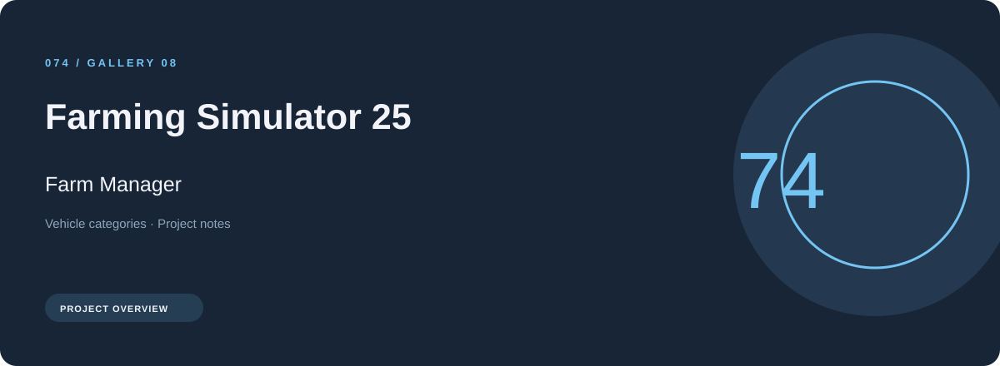
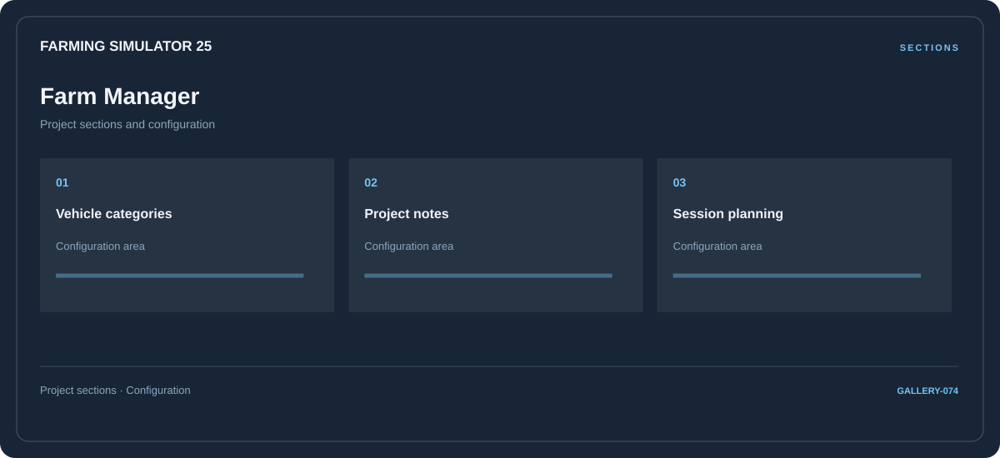

# ⚡ Farming Simulator 25 Farm Manager

**Vehicle categories · Project notes · Session planning**

## ⚡ Features

A farm manager workspace for Farming Simulator 25, built around vehicle categories and project notes, with session planning kept in a separate reference area.

### ⚙️ Vehicle categories

A dedicated section for vehicle categories and the configuration details associated with that area.

### 🧩 Project notes

A dedicated section for project notes and the configuration details associated with that area.

### ⌨️ Session planning

Session and activity information grouped by the task or context it belongs to.

## 🖥️ Project navigation

## 📥 Download

The button and cover open the project's download page. Use the information supplied with the downloaded package for installation and release-specific requirements.

## 📚 Project documentation

- [Feature reference](docs/FEATURES.md)
- [Download information](docs/DOWNLOAD.md)
- [Project page](index.html)

---

Farming Simulator 25 Farm Manager · Program documentation and download information.
